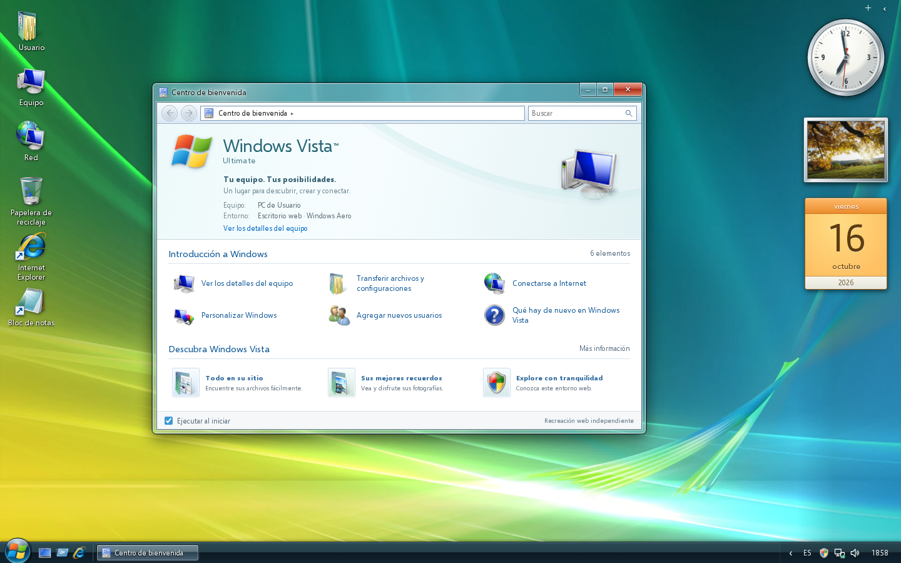

# Windows Vista · Aero Desktop

Una recreación interactiva del escritorio de **Windows Vista Ultimate**, en español, para el navegador. Cristal Aero, fondo Aurora, Inicio de dos columnas, barra de tareas con botones de texto, ventanas y gadgets. Sin framework en tiempo de ejecución, sin backend, sin CDN y sin cuentas.

> **Alcance:** es una recreación web independiente, no Windows ni una máquina virtual. Implementa todas las funciones base descritas más abajo. No se certifica identidad literal píxel a píxel con el sistema nativo: la composición, la tipografía, algunos detalles y las restricciones del navegador son diferentes. Consulte [LIMITATIONS.md](docs/LIMITATIONS.md) y los avisos sobre los recursos de Microsoft antes de publicar.



## Abrir el proyecto

Requisitos de desarrollo: **Node.js 22.19 o posterior** y npm. La versión recomendada está en `.nvmrc`. Para utilizar el sitio ya compilado no hace falta Node en el servidor.

```bash
npm ci
npm run dev
```

Abra la dirección que muestra Vite, normalmente `http://localhost:5173`. No abra el `index.html` fuente mediante `file://`: los módulos ES necesitan un servidor HTTP.

### Compilación de producción

```bash
npm run build
npm run preview
```

Vite produce `dist/`: HTML, CSS, JavaScript y recursos estáticos. **No hay servicio Node que desplegar.** El script de compilación también comprueba los presupuestos de tamaño y falla si se exceden.

En la entrega se incluye además **`site/`**, una copia ya compilada, lista para copiar a un alojamiento estático. Por ejemplo, sin instalar dependencias JavaScript:

```bash
python3 -m http.server 8080 --directory site
```

Abra `http://localhost:8080`. En Windows puede utilizar `py -m http.server 8080 --directory site`.

## Publicar automáticamente en GitHub Pages

1. Descomprima el proyecto y suba **su contenido a la raíz del repositorio**, incluidos `package-lock.json` y `.github/workflows/pages.yml`.
2. Use una rama llamada `main` o `master` —ambas están contempladas—, o cambie esas ramas en el workflow.
3. En **Settings → Pages → Build and deployment → Source**, seleccione **GitHub Actions**. Debe tener permisos para configurar Pages en el repositorio.
4. Haga un push. El workflow instala las dependencias bloqueadas, audita, comprueba el formato, ejecuta pruebas unitarias, compila, prueba Chromium y Firefox y comprueba los presupuestos de rendimiento.
5. Solo si todo pasa, publica el contenido de `dist/` mediante las acciones oficiales de Pages. La URL aparece en el job `deploy` y en Settings → Pages.

No requiere un token personal, un servicio de pago ni variables de entorno secretas. La disponibilidad de Pages depende de la configuración y el plan del repositorio. **El proyecto se entrega preparado; no se ha creado ni publicado un repositorio por usted.**

### Repositorio de proyecto, dominio raíz o dominio propio

`base: './'` en Vite y las URL relativas de los recursos permiten servir el mismo build en:

- `https://usuario.github.io/mi-repositorio/`
- `https://usuario.github.io/`
- Un dominio propio configurado en Pages.

Hay una prueba de integración que sirve la compilación en una subruta real `/vista-test/`. No hay rutas SPA que necesiten reescrituras: el Explorador y el navegador simulado navegan dentro de la aplicación.

Si prefiere el despliegue manual, copie **el contenido de `site/`**, no la carpeta contenedora, a la raíz de una rama de publicación y seleccione esa rama en Pages. `.nojekyll` ya está incluido. No combine ese método con el workflow automático sin ajustar su configuración.

## Qué funciona

| Componente           | Funciones implementadas                                                                                                                                                                                                                                                             |
| -------------------- | ----------------------------------------------------------------------------------------------------------------------------------------------------------------------------------------------------------------------------------------------------------------------------------- |
| Escritorio           | Selección simple y múltiple, rectángulo de selección, doble clic, accesos directos, arrastre y posiciones persistentes, menús contextuales, tamaños y orden de iconos, creación de archivos y carpetas.                                                                             |
| Ventanas             | Captura de puntero, arrastre, ocho zonas de redimensionamiento, límites, tamaño mínimo, foco y z-index, maximizar, minimizar, restaurar, cerrar y confirmación de cambios sin guardar. Doble clic en el título y menú de sistema; mover y redimensionar con flechas desde ese menú. |
| Barra de tareas      | Inicio rápido, mostrar/restaurar escritorio, agrupación de instancias configurable, seleccionar ventanas, minimizar/restaurar grupos, previsualizaciones, cascada y mosaico, administrador de ventanas simulado.                                                                    |
| Inicio               | Dos columnas, usuario, programas recientes, todos los programas, búsqueda de programas y archivos sin distinguir acentos, navegación por teclado, vínculos a carpetas, bloqueo, apagado y reinicio simulados.                                                                       |
| Explorador           | Equipo, C:, D:, DVD visual, carpetas y breadcrumbs, atrás/adelante, historial, búsqueda, iconos/detalles/lista, crear, renombrar, importar texto, arrastrar archivos de texto desde el dispositivo, propiedades, Papelera, restaurar y vaciar.                                      |
| Bloc de notas        | Edición real, nuevo, abrir texto del dispositivo, guardar y guardar como en el sistema virtual, exportar `.txt`, imprimir, selección, portapapeles según permisos, buscar, fuente, ajuste de línea, fecha/hora, estado y recuperación de borradores.                                |
| Calculadora          | Estándar y científica, operaciones inmediatas y encadenadas, repetir igual, porcentajes, signo, raíz, inverso, memoria, grados, teclado y tratamiento de errores. Sin `eval`.                                                                                                       |
| Internet Explorer    | Páginas locales tipo Windows Live, ayuda, buzón de muestra, fotografías, búsqueda local, pestañas, historial por pestaña, favoritos persistentes, zoom y barra de direcciones. Los sitios externos se abren en una pestaña real solo tras un clic explícito.                        |
| Galería fotográfica  | Miniaturas, visor, anterior/siguiente, presentación, giro visual, zoom, ajustar, información y descarga de imágenes.                                                                                                                                                                |
| Paint                | Lápiz, pincel, borrador, relleno por área, cuentagotas, texto, líneas, rectángulos, elipses, color y grosor, deshacer/rehacer, abrir imagen y exportar PNG.                                                                                                                         |
| Buscaminas           | Tablero 9×9, 10 minas, primer clic seguro, apertura en cascada, banderas, teclado, reloj, victoria/derrota y estadísticas locales.                                                                                                                                                  |
| Sidebar              | Reloj analógico vivo, segundero configurable, nombre del reloj, diapositivas, calendario, notas persistentes, galería de gadgets, agregar/quitar y reordenar por arrastre.                                                                                                          |
| Personalización      | Fondos de Vista, color e intensidad del cristal, transparencia, nombre del usuario, Sidebar, sonidos sintetizados opcionales y reducción de movimiento.                                                                                                                             |
| Área de notificación | Hora del dispositivo, calendario navegable, volumen de los sonidos de la app, indicador `navigator.onLine`, idioma y acceso al panel de seguridad informativo.                                                                                                                      |

Vista **no tenía Aero Snap**. No se ha añadido el ajuste de ventanas al arrastrar al borde propio de Windows 7. Se conserva una barra con icono **y texto**, no la Superbar de Windows 7.

## Datos, privacidad y seguridad

- Documentos, preferencias, posiciones, favoritos y borradores se guardan solo en `localStorage`, con claves que comienzan por `vista.`.
- No hay analítica, anuncios, telemetría, cuentas remotas ni solicitudes a terceros desde la aplicación. Los recursos están incluidos en el proyecto.
- Importación de texto: hasta **1 MB por documento**. Sistema de archivos virtual: límite conservador aproximado de **2,5 MB serializados** y 350 elementos. También se respetan las cuotas reales del navegador.
- Los archivos son virtuales. No se accede al disco real salvo que el usuario elija un archivo o descargue uno. Las capacidades de las unidades son ilustrativas.
- Los borradores se conservan al recargar o salir y se recuperan al arrancar, hasta 10 según la cuota disponible. Guardar o descartar un documento elimina su borrador.
- Borrar los datos del sitio, el modo privado, cambiar de origen o las políticas del navegador pueden eliminar o impedir el almacenamiento. **Descargue una copia de lo importante.** No es una solución de almacenamiento con garantías de copia de seguridad.
- Los nombres y contenidos se escapan al mostrarlos. No se ejecutan documentos, HTML importado, direcciones `javascript:` ni programas `.exe`.
- Una CSP impide scripts inline, plugins y recursos de orígenes externos. Las URL externas solo admiten HTTP(S); se abren con `noopener,noreferrer`.
- Para reiniciar los datos durante desarrollo, elimine únicamente las claves `vista.*` desde las herramientas del navegador. No hace falta borrar otros datos del origen.

## Teclado y accesibilidad

| Atajo                    | Acción                                                          |
| ------------------------ | --------------------------------------------------------------- |
| Ctrl+Esc                 | Inicio                                                          |
| Ctrl+Alt+D               | Mostrar/restaurar escritorio                                    |
| Ctrl+Alt+N / Ctrl+Alt+C  | Nuevo Bloc de notas / Calculadora                               |
| Alt+`                    | Cambiar entre ventanas                                          |
| Alt+F4                   | Cerrar la ventana, si el navegador recibe el atajo              |
| F1                       | Ayuda                                                           |
| Ctrl+S / Ctrl+Mayús+S    | Guardar / Guardar como en Bloc de notas                         |
| Ctrl+F / F5              | Buscar / insertar fecha y hora en Bloc de notas                 |
| F2 / Supr                | Renombrar / eliminar en Explorador                              |
| Ctrl+Mayús+N             | Nueva carpeta en Explorador                                     |
| Ctrl+L / Ctrl+T / Ctrl+W | Dirección / nueva pestaña / cerrar pestaña en Internet Explorer |
| Flechas / F              | Moverse por Buscaminas / colocar bandera                        |

Los botones tienen nombres accesibles, los diálogos modales contienen el foco, los menús admiten flechas y Escape y se respeta `prefers-reduced-motion`. Hay un ajuste adicional de reducción de animaciones. **El aspecto es deliberadamente compacto como Vista**: no se declara conformidad WCAG completa ni una experiencia táctil equivalente a la del ratón.

## Pruebas y rendimiento

```bash
npm ci
npx playwright install --with-deps chromium firefox
npm test
npm run build
npm run test:e2e
```

Para las mediciones Lighthouse y de interacción, deje `npm run preview` abierto en otra terminal:

```bash
npm run test:performance
```

- Resultados finales y alcance: [docs/QA.md](docs/QA.md).
- Mediciones reproducibles: [docs/PERFORMANCE.md](docs/PERFORMANCE.md).
- Informes completos: `docs/e2e-results.json`, `docs/unit-results.xml`, `docs/lighthouse-*.json` y `docs/lighthouse-*.html`.
- Presupuestos: JS gzip ≤55 kB, CSS gzip ≤25 kB, sitio completo ≤3,5 MB; además, umbrales de Lighthouse, transferencia, fotogramas, apertura y memoria.

Se prueban los navegadores Chromium y Firefox automatizados, y viewports 1440×900, 1280×720, 1024×768 y 390×844. El diseño está pensado principalmente para escritorio. No se han realizado pruebas manuales en todos los sistemas operativos ni se certifica Safari.

```bash
npm run format       # Formatear código fuente
npm run format:check # Verificar formato
npm run pack         # Compilar y generar los ZIP de fuente y sitio estático
```

## Estructura

```text
vista-desktop/
├── .github/workflows/pages.yml   # Validación y despliegue automático
├── index.html                   # Shell semántico y CSP
├── package.json / package-lock.json
├── vite.config.js               # Base relativa y compilación estática
├── playwright.config.js
├── src/
│   ├── main.js                  # Composición, tema y reloj compartido
│   ├── app-registry.js          # Lanzamiento e instancias
│   ├── window-manager.js        # Estado y geometría de ventanas
│   ├── shell.js                 # Escritorio, Inicio, tareas y bandeja
│   ├── sidebar.js               # Gadgets y reloj SVG
│   ├── ui.js                    # Menús, diálogos e importación
│   ├── store.js                 # Persistencia y preferencias
│   ├── filesystem.js            # Modelo transaccional de archivos
│   ├── calculator-model.js      # Calculadora sin evaluación de código
│   ├── minesweeper-model.js     # Lógica de Buscaminas
│   ├── utils.js
│   ├── theme.css / shell.css / apps.css
│   └── apps/
│       ├── welcome.js / explorer.js / notepad.js
│       ├── calculator.js / browser.js / settings.js
│       └── photos.js / paint.js / games.js
├── public/
│   ├── .nojekyll / robots.txt
│   └── assets/                  # Iconos, cursores, fondos, miniaturas, fuentes y SVG
├── tests/                       # Unitarias y pruebas reales de navegador
├── scripts/                     # Presupuestos, rendimiento, empaquetado y espera CI
├── docs/                        # Arquitectura, límites, inventario y resultados
├── site/                        # Compilación incluida en el ZIP de entrega
├── LICENSE
└── THIRD_PARTY_NOTICES.md
```

`dist/`, dependencias y cachés se generan; no son necesarios en el repositorio. `site/` es una comodidad de la entrega: la publicación automática siempre recompila el código fuente, no depende de esa copia.

## Licencias y marcas

El código original del proyecto se ofrece bajo la licencia MIT de `LICENSE`. Esa licencia **no incluye ni relicencia** los fondos, iconos, cursores, marcas o logotipos de Microsoft ni las fotografías de terceros. Selawik se distribuye bajo SIL OFL.

Consulte **[THIRD_PARTY_NOTICES.md](THIRD_PARTY_NOTICES.md)** para las fuentes y los derechos de los recursos. Su presencia en un archivo público no implica autorización de redistribución comercial. Revise los permisos para su caso de publicación; sustituya los recursos si necesita una distribución íntegramente bajo licencias abiertas. Proyecto no afiliado, aprobado ni patrocinado por Microsoft.
